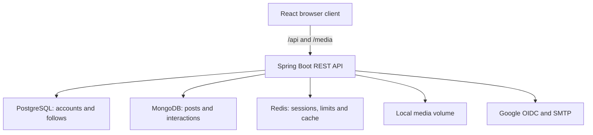
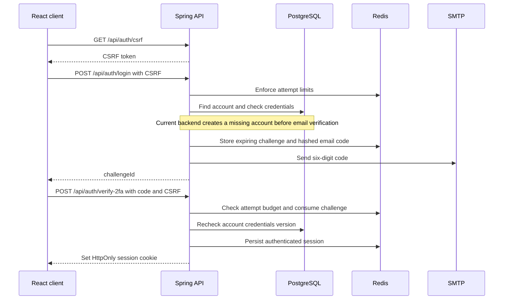
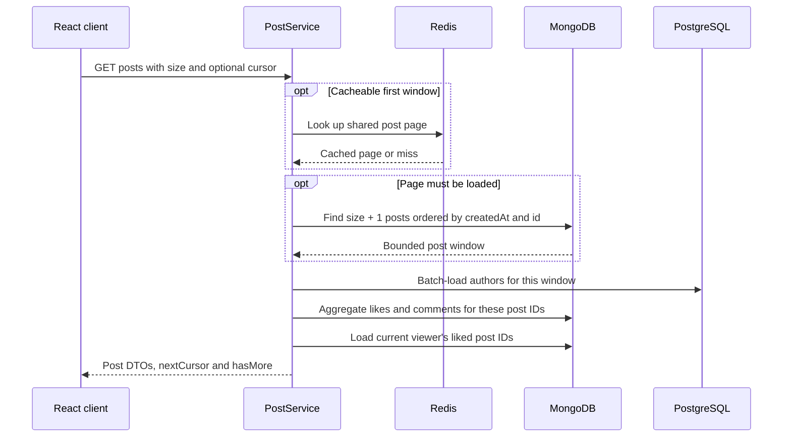
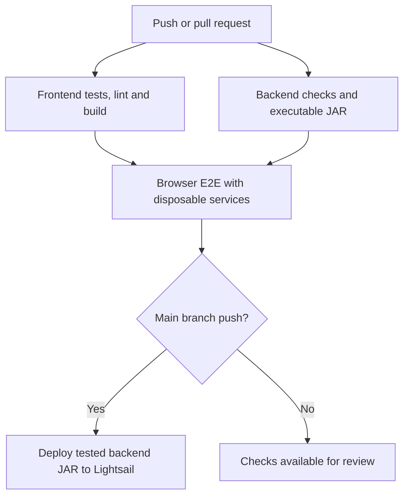

# X-copy

### A full-stack social feed built with React and Spring Boot

[](https://github.com/Cadosca156/x-copy/actions/workflows/ci.yml)

X-copy is a personal project inspired by X/Twitter. Users can sign in, publish text
and media, follow other accounts, like posts, and join discussions. The project
focuses on the engineering behind these interactions: authentication, database
queries, concurrency, retries, and automated verification.

**Status:** active development. This is a portfolio project with an implemented
CI/deployment pipeline; production capacity has not been established by load testing.

[Architecture](#architecture) · [Authentication](#authentication) · [Feed](#how-the-feed-is-built) · [Run locally](#run-locally) · [Tests](#testing-and-ci) · [Code tour](#code-tour)

## What you can do

| Area | Implemented behavior |
| --- | --- |
| Authentication | Email/password login and registration followed by a six-digit email code; Google OpenID Connect login |
| Account recovery | Expiring, single-use reset links; password reset revokes existing sessions |
| Profiles | Username and display-name setup, profile editing, and avatar uploads |
| Publishing | Text posts up to 280 UTF-16 code units, supported image/video uploads, and author-controlled deletion |
| Social interactions | Explicit like/unlike, comments and comment deletion, follow/unfollow, and account suggestions |
| Reading | Global, profile, and following feeds with cursor-based pagination |

Explore, notifications, messaging, bookmarks, reposts, and trends are currently
interface placeholders rather than completed backend features.

## Architecture

The backend is a **modular monolith**. Features are grouped into packages with
controllers, services, repositories, DTOs, and domain-specific errors.



In development, Vite proxies API and media requests to Spring Boot. The deployment
configuration uses AWS Amplify for the frontend and a Docker Compose backend on
Lightsail, behind a reverse proxy.

### Stack

| Layer | Technologies |
| --- | --- |
| Client | React 19, React Router 7, Vite 8, JavaScript, CSS, Lucide icons |
| Server | Java 17 target, Spring Boot 4, Spring Security, Spring Data, Lombok |
| Persistence | PostgreSQL 16, MongoDB 8, Redis 7 |
| Authentication | Spring Session Redis, BCrypt, Google OAuth 2.0 / OpenID Connect |
| Verification | JUnit, Mockito, Spring integration tests, Node.js tests, Playwright |
| Delivery | Gradle Wrapper, Docker Compose, GitHub Actions, AWS Amplify and Lightsail |

CI runs Gradle using Java 21 while compiling application code for Java 17.

### Why three databases?

| Store | Responsibility | Trade-off |
| --- | --- | --- |
| PostgreSQL | Users, profile fields, follow relationships, and password-reset records | Relational constraints and transactions protect account data |
| MongoDB | Posts, comments, likes, and durable post-deletion jobs | Document queries fit the feed; author IDs are application-level references to PostgreSQL |
| Redis | Browser sessions, short-lived authentication challenges, rate limits, and cached post pages | Shared state works across backend processes, but Redis availability is important for authentication |

There is no transaction spanning PostgreSQL, MongoDB, and the filesystem. Services
use compensation and retryable cleanup where needed. A post whose SQL author no
longer exists can still be displayed with a deleted-user fallback.

## Authentication

The browser uses an opaque **server-side session**, not a JWT in localStorage.
Spring Session stores the security context in Redis. The session cookie is
HttpOnly, SameSite=Lax, and Secure by default.

### Email login



The login challenge is an opaque secret; a public user ID cannot be substituted
for it. Codes expire after five minutes and allow five verification attempts per
challenge. Resending does not reset the challenge expiry or attempt budget.

Mutating client requests obtain a CSRF token and send it in `X-XSRF-TOKEN`.
Subsequent API calls authenticate through the session cookie. Logout deletes the
current browser session; password reset revokes the account's existing sessions.
Sessions have a 30-minute idle timeout and a one-day absolute lifetime.

### Google login

1. The frontend requests a browser-bound OAuth start token.
2. Spring Security performs the authorization-code flow with Google and checks
   that the returned email is verified.
3. The callback redirects to the frontend with a short-lived, one-use handoff code.
4. The frontend removes the code from the address bar and exchanges it for a
   server-side session. The exchange checks the initiating browser's binding cookie.
5. Accounts without a password are routed through password setup; incomplete
   profiles are routed through profile setup.

The redirect contains a handoff code, not a reusable session credential.

## How the feed is built



The extra record determines whether another page exists. The cursor carries the
last post's timestamp and ID and is checked against its feed scope. Queries return
at most 50 visible posts per request.

Author data and interaction metadata are fetched in batches, rather than through
repository calls inside a per-post loop. The first global/profile window can be
cached for 30 seconds; viewer-specific like state is assembled separately.
The following feed resolves followed account IDs in PostgreSQL before querying
MongoDB. Large follow lists remain a scaling consideration.

## Reliability and security decisions

| Concern | Current implementation |
| --- | --- |
| Password storage | BCrypt hashes, with a UTF-8 byte limit compatible with BCrypt |
| Brute-force attempts | Shared Redis account/IP limits and bounded code attempts; Redis failures do not bypass the limits |
| Authorization | Backend-derived actor identity and ownership checks for post/comment deletion |
| Recovery privacy | Same public recovery response for known and unknown emails; bounded background delivery queue |
| Like retries | PUT sets liked state and DELETE clears it; a unique post/user index prevents duplicate likes |
| Upload abuse | Generated filenames, file-signature checks, per-user/global byte and file quotas, and reserved disk space |
| Overload | Bounded request concurrency, database pools, queues, and timeouts; excess work receives retryable errors |
| Post deletion | Tombstoned posts carry cleanup jobs; a scheduled worker retries media and child-record cleanup |
| API consistency | Typed error mapping and a shared post-response fixture consumed by frontend/backend tests |

File-signature validation does not constitute malware scanning. Local media
storage and the single-server deployment are deliberate current limitations.

### Release hardening in progress

Additional changes are prepared separately for optimistic account versioning,
registration that persists credentials only after email verification, and
idempotent post creation. **They are not yet applied to the main backend working
directory.** The current frontend already sends post-creation retry keys, but that
alone does not make the current backend idempotent.

See [release-hardening status](frontend/docs/RELEASE_SAFETY_UK.md) for the patch,
verification results, and remaining integration checks. Architecture descriptions
above follow the current backend rather than assuming those changes are deployed.

## Run locally

Commands below start from the **repository root**, which contains `backend/`,
`frontend/`, and `docker-compose.yaml`.

### Prerequisites

- Docker with Docker Compose.
- Node.js 24, matching CI.
- JDK 21 to run the current Gradle Wrapper and an available JDK 17 toolchain for
  compilation. Set `JAVA_HOME` to JDK 21 if necessary.
- SMTP credentials for delivered email codes; Google OAuth credentials for Google login.

### 1. Configure the services

Create a root `.env` with your own values. Do not commit it.

```dotenv
PSQL_NAME=xcopy
PSQL_USER=xcopy
PSQL_PASSWORD=replace-with-a-local-password
MDB_NAME=xcopy
MAIL_USERNAME=your-smtp-account
MAIL_PASSWORD=your-smtp-app-password
GOOGLE_CLIENT_ID=your-google-client-id
GOOGLE_CLIENT_SECRET=your-google-client-secret
FRONTEND_URL=http://localhost:5173
GOOGLE_REDIRECT_URI=http://localhost:8080/login/oauth2/code/google
SESSION_COOKIE_SECURE=false
```

The current mail configuration uses Gmail SMTP with STARTTLS. Configure Google's
authorized callback URL to match `GOOGLE_REDIRECT_URI` when using Google login.
`SESSION_COOKIE_SECURE=false` is only for local HTTP development.

### 2. Build and start the backend

```sh
cd backend
./gradlew bootJar
cd ..
docker compose up --build -d
```

On Windows PowerShell, replace `./gradlew` with `.\gradlew.bat`.
The Dockerfile consumes the previously built executable JAR. The backend is
published on `127.0.0.1:8080`; database ports are not exposed by this Compose file.

### 3. Start the frontend

```sh
cd frontend
npm ci
npm run dev
```

Open **http://localhost:5173**. Vite proxies `/api` and `/media` to port 8080.
For local Google login, set `VITE_OAUTH_BASE_URL=http://localhost:8080` in
`frontend/.env.development.local` if the environment overrides the default.

To stop the application without removing its database/media volumes:

```sh
docker compose stop
```

## Testing and CI

| Layer | What is checked |
| --- | --- |
| Frontend tests | Cookie/CSRF requests, password flows, post contracts, pagination, like state, and submission retries |
| Backend unit tests | Validation, authorization, rate limits, authentication challenges, cache behavior, and resource limits |
| Integration tests | Real Redis sessions/atomic operations, MongoDB indexes and queries, SQL behavior, and deletion recovery |
| Browser E2E | Real application flows with PostgreSQL, MongoDB, Redis, Mailpit, and a local OIDC provider |

```sh
# Frontend
cd frontend
npm test
npm run lint -- --max-warnings=0
npm run build

# Backend: full checks need the configured external services
cd ../backend
./gradlew check bootJar
```

The backend also defines `./gradlew unitTest` for an isolated-test subset.
See [E2E instructions](frontend/e2e/README.md) for the disposable test stack and
browser runner. E2E exercises the OIDC protocol locally; it does not test Google's
live consent screens or production credentials.



The [workflow](.github/workflows/ci.yml) gates backend deployment on frontend,
backend, and E2E checks. Frontend delivery is handled by Amplify. Deployment uses
SSH host-key verification and serializes backend releases. Automatic rollback is
not configured. See [deployment instructions](frontend/DEPLOYMENT.md).

## Code tour

Suggested reading order for reviewing the implementation:

| Start here | What to look for |
| --- | --- |
| [Frontend API helper](frontend/src/api/api.js) | Shared cookie/CSRF contract and error handling |
| [Security configuration](backend/src/main/java/com/net/cardo/xcopybackend/security/SecurityConfig.java) | Request authorization, CSRF, OAuth, and filter ordering |
| [Browser sessions](backend/src/main/java/com/net/cardo/xcopybackend/security/BrowserSessionService.java) | Session issuance, OAuth handoff, logout, and revocation |
| [Post service](backend/src/main/java/com/net/cardo/xcopybackend/post/service/PostService.java) | Feed assembly, batch reads, cursor windows, creation, and ownership |
| [Cursor queries](backend/src/main/java/com/net/cardo/xcopybackend/post/repository/PostWindowRepositoryImpl.java) | Stable ordering, database bounds, and query deadlines |
| [Post cleanup](backend/src/main/java/com/net/cardo/xcopybackend/post/service/PostCleanupService.java) | Durable jobs, worker leases, backoff, and orphan repair |
| [Shared API fixture](frontend/contracts/post-response.json) | Response shape checked by both sides |
| [Browser scenarios](frontend/e2e/security.spec.mjs) | Cross-feature behavior and adversarial cases |

More implementation notes:
[Redis sessions](frontend/docs/REDIS_SESSIONS_UK.md) ·
[Batch queries](frontend/docs/BATCH_FEED_QUERIES_UK.md) ·
[Cursor pagination](frontend/docs/CURSOR_FEED_UK.md) ·
[MongoDB indexes](frontend/docs/MONGODB_INDEXES_UK.md) ·
[Deletion recovery](frontend/docs/RELIABLE_POST_DELETION_UK.md).

## Next engineering milestones

- Apply and integration-test the prepared account/registration/post-retry fixes.
- Add off-server backups and verify a coordinated restore of databases and media.
- Add operational metrics, alerts, dependency readiness checks, and rollback.
- Measure feed, authentication, upload, and popular-post workloads under load.
- Introduce controlled schema migrations and review account/email normalization.
- Move media to object storage/CDN and queue login email delivery as traffic grows.
- Add moderation, reporting, and stronger controls against automated account creation.

These milestones describe planned work, not existing production guarantees.
