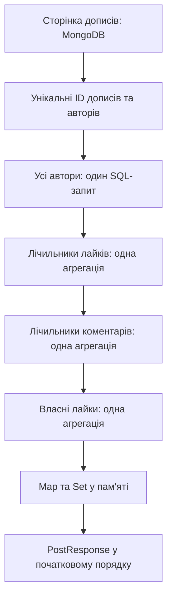

# Як я прибрав окремі запити для кожного допису

Оновлення пункту 3: політика кешу тепер описана в [FEED_CACHE_UK.md](FEED_CACHE_UK.md). Кешуються спільні сторінки `Post`, а пакетне доповнення виконується на кожному читанні. Опис старого кешу нижче пояснює стан на момент першого кроку.

Це пояснення оптимізації першого пункту: пакетне отримання авторів, лічильників і власних лайків для сторінки стрічки. Реалізація розташована в бекенді; фронтенд продовжує отримувати той самий PostResponse.

Продовження: [міграція індексів MongoDB](MONGODB_INDEXES_UK.md) додає захист від повторних лайків. Після неї інтеграційний тест пакетних запитів перевіряє відхилення повторної вставки базою; самі пакетні агрегації залишаються такими, як описано нижче.

## 1. Яку проблему ми вирішуємо

Раніше PostService спочатку отримував сторінку дописів, а потім для кожного допису окремо:

1. Шукав автора в PostgreSQL через findById.
2. Рахував лайки в MongoDB через countByPostId.
3. Рахував коментарі в MongoDB через countByPostId.
4. Перевіряв власний лайк через existsByPostIdAndUserId.

Метод перетворення одного допису на відповідь одночасно виконував ці запити. Виклик mapper усередині stream().map(...) приховував звернення до бази в циклі.

Це різновид проблеми N+1: після початкового запиту виконується додаткова робота для кожного елемента. Тут додаткових операцій чотири, тому точніша формула на рівні викликів репозиторіїв — 1 + 4N.

| Дописів у сторінці | Раніше: виклики репозиторіїв для читання | Тепер: типовий випадок |
|---:|---:|---:|
| 1 | 5 | 5 |
| 20 | 81 | 5 |
| 50 | 201 | 5 |

Важливе уточнення: це бюджет роботи завантажувача дописів на промаху кешу. Він не включає авторизацію, пошук користувача в контролері, визначення підписок, Redis, службові команди драйверів або мережеві повтори. У старій реалізації фактичних SQL-команд могло бути менше за кількість findById, якщо той самий автор уже був у контексті Hibernate. Однак три окремі MongoDB-операції на кожен допис усе одно залишалися.

## 2. Ідея нового рішення

Замість «для кожного допису отримати всі його дані» я роблю «для всієї сторінки отримати кожен вид даних одним пакетом».

Для непорожньої сторінки з коректними ID авторів виходить:

1. Один запит MongoDB за самою сторінкою дописів.
2. Один запит PostgreSQL за всіма потрібними авторами.
3. Одна MongoDB-агрегація кількості лайків.
4. Одна MongoDB-агрегація кількості коментарів.
5. Одна MongoDB-агрегація ID дописів, які лайкнув поточний користувач.

Після цього відповіді складаються в пам’яті. Усередині циклу формування PostResponse звернень до бази вже немає.



Запити наразі виконуються послідовно, як показано на схемі. Основний виграш дає скорочення кількості звернень, без додавання потоків і конкурентного навантаження на бази.

## 3. Що саме змінено у файлах

Шляхи нижче вказані від кореня репозиторію x-copy.

| Файл | Зміна |
|---|---|
| backend/.../post/service/PostService.java | Спільний toResponses для сторінки; чистий toResponse для одного DTO |
| backend/.../post/repository/LikeRepository.java | countForPosts та findLikedPostIds |
| backend/.../post/repository/CommentRepository.java | countForPosts |
| backend/.../post/repository/projection/PostCount.java | Малий результат агрегації: postId і long count |
| backend/.../post/repository/projection/LikedPostId.java | Малий результат: лише postId |
| backend/.../post/service/PostServiceTest.java | Попередні регресійні тести переведені на пакетні методи |
| backend/.../post/service/PostServiceBatchTest.java | Перевірки бюджету запитів, порядку, нулів, порожньої сторінки та помилок |
| backend/.../post/service/PostFeedBatchIntegrationTests.java | Перевірка справжніх агрегацій та підрахунок команд MongoDB/SQL |
| backend/build.gradle | Новий інтеграційний тест виключено з автономної команди unitTest; звичайний test/check його запускає |

Повний префікс Java-шляхів: src/main/java/com/net/cardo/xcopybackend або src/test/java/com/net/cardo/xcopybackend відповідно.

## 4. Пакет авторів

Спочатку зі сторінки збираються authorIds. Один автор може мати багато дописів, тому використовується distinct(): наприклад, двадцять дописів одного автора дають лише один UUID у списку.

Некоректні або відсутні UUID відкидаються перед SQL-запитом. Для решти використовується наявний JpaRepository.findAllById:

```java
userRepository.findAllById(authorIds);
```

За змістом це запит:

```sql
SELECT ... FROM users WHERE id IN (...);
```

Повернені User складаються в Map<UUID, User>. Тепер для кожного допису достатньо authors.get(authorId) у пам’яті.

Зберігається попередня поведінка для старих даних: якщо автора видалено, його ID некоректний або відсутній, допис залишається у стрічці з підписом «Видалений користувач». Помилка доступу до самої бази при цьому не перетворюється на «видаленого користувача» — виняток продовжує передаватися нагору.

## 5. Пакет лічильників лайків і коментарів

У репозиторіях використано @Aggregation із трьома етапами:

```javascript
[
  { $match: { postId: { $in: ["p1", "p2", "p3"] } } },
  { $group: { _id: "$postId", count: { $sum: 1 } } },
  { $project: { _id: 0, postId: "$_id", count: 1 } }
]
```

- $match залишає документи лише для ID поточної сторінки.
- $group об’єднує їх за postId.
- $sum: 1 рахує кількість документів у кожній групі.
- $project задає компактну форму результату для Java: postId та count.

Для лайків цей конвеєр виконується в likes, для коментарів — у comments. Параметр ?0 у Java-анотації замінюється списком ID через Spring Data.

Приклад результату:

```json
[
  { "postId": "p1", "count": 7 },
  { "postId": "p3", "count": 2 }
]
```

Для p2 групи немає, якщо відповідних документів немає. На рівні відповіді це означає нуль: використовується map.getOrDefault(postId, 0L).

Ми отримуємо від бази до одного рядка на допис. Навіть якщо у допису багато лайків, Java не завантажує всі ці Like-документи для підрахунку.

Тип count — long. Відсутність групи означає нуль лише після успішного виконання запиту; збій бази не підміняється порожнім результатом.

Семантика підрахунку збережена: рахується кількість Like-документів, як робив старий countByPostId. Виправлення дублікатів лайків та унікальний індекс — окреме завдання.

## 6. Пакет власних лайків

Запит має два фільтри: ID дописів поточної сторінки та userId поточного користувача:

```javascript
[
  { $match: { postId: { $in: ["p1", "p2", "p3"] }, userId: "viewer-id" } },
  { $group: { _id: "$postId" } },
  { $project: { _id: 0, postId: "$_id" } }
]
```

Результат складається у Set<String>. Відповідь для допису отримує:

```java
likedByViewer.contains(post.getId());
```

Фільтрація за viewerId не дає використати лайк іншої людини як власний. Групування також прибирає дублікати ID у результаті, якщо старі дані вже містять повторні лайки одного користувача.

Set містить щонайбільше стільки ID, скільки дописів у сторінці. Запит не завантажує історію всіх лайків користувача.

## 7. Для чого Map і Set

Уявімо сторінку p1, p2, p3. Після запитів маємо:

```text
authors = { A -> Alice, B -> Bob }
likes = { p1 -> 7, p3 -> 2 }
comments = { p2 -> 4 }
likedByViewer = { p3 }
```

Для p1 ми беремо автора з authors, число 7 із likes, нуль із comments і false із likedByViewer. Для p3 — відповідного автора, 2 лайки, нуль коментарів і true.

Пошук у HashMap/HashSet зазвичай має середню складність O(1). Завдяки цьому не потрібно для кожного допису заново переглядати весь список авторів або результатів агрегації.

Важливо: toResponse тепер лише складає поля DTO. Він не знає про репозиторії й не виконує I/O. Відокремлення отримання даних від їхнього форматування робить вартість операції видимою.

## 8. Чому порядок стрічки зберігається

findAllById і MongoDB-агрегації не зобов’язані повертати результати в порядку переданих ID. Тому я не будую стрічку з порядку їхніх результатів.

Наприкінці код проходить саме початковий List<Post>, який уже отримано з потрібним сортуванням і пагінацією. Дані лише підставляються за ID. Таким чином, найновіший допис не може переміститися через інший порядок авторів або груп лічильників.

## 9. Де використовується спільний код

toResponses використовується для:

- загальної стрічки getPosts;
- дописів конкретного автора getUserPosts;
- стрічки підписок getPostsByAuthors;
- відповіді після створення одного допису.

Останній випадок передає список з одного елемента. Для одного допису число читань не зменшується, але зберігається єдиний спосіб побудови відповіді.

Для порожньої сторінки повертається порожній список без запитів за авторами, лічильниками чи лайками. Якщо коректних ID авторів немає, SQL-запит також пропускається.

## 10. Як перевіряється оптимізація

PostServiceBatchTest перевіряє сторінки з 1, 20 і 50 елементів. Для кожної перевіряються рівно одна операція читання дописів, одна findAllById та три пакетні MongoDB-операції. verifyNoMoreInteractions виявить повернення прихованих count/exists/findById у циклі.

Інші unit-тести перевіряють:

- збереження порядку при перемішаних результатах авторів і агрегацій;
- нульові лічильники та false для відсутнього власного лайка;
- порожню сторінку без додаткових звернень;
- використання пакетного коду в профілі та підписках;
- збереження винятку при недоступності бази;
- старі дописи видалених авторів.

PostFeedBatchIntegrationTests працює зі справжніми базами. MongoDB CommandListener рахує команди find та aggregate; Hibernate Statistics рахує підготовлені SQL-оператори. Для холодної сторінки профілю з двадцяти дописів тест вимагає один find, три aggregate, нуль getMore та один SQL-оператор. Він також перевіряє справжні результати агрегації, виключення документів поза сторінкою, дублікати та ізоляцію viewerId.

Статистика очищається після підготовки даних, тому вставки тестових документів не потрапляють до вимірювання. Випадкові ID автора та користувача забезпечують новий ключ кешу.

Команди:

```text
backend:  .\gradlew.bat unitTest
backend:  .\gradlew.bat test --tests '*PostFeedBatchIntegrationTests'
frontend: npm run test:e2e
```

Для інтеграційних тестів потрібні ізольовані PostgreSQL, MongoDB та Redis із тестовими змінними середовища. Для E2E слід дотримуватися frontend/e2e/README.md. Команда unitTest не потребує цих сервісів.

## 11. Межі результату

Для двадцяти дописів типовий бюджет завантажувача зменшився з 81 до 5 викликів репозиторіїв — приблизно на 94%. Це не означає прискорення всього HTTP-запиту на 94%: потрібні заміри часу, даних, CPU та конкурентного навантаження.

Сталою є кількість логічних звернень на обмежену сторінку. Обсяг роботи всередині MongoDB залежить від кількості лайків/коментарів та індексів. Пакетні запити не замінюють оптимізацію індексів.

Пагінація, формат PostResponse та правила доступу збережені. Індекси, стратегія кешу, налаштування пулів і облік дискового простору цим пунктом не змінюються.

Дані отримуються кількома послідовними запитами з двох різних баз. Якщо хтось одночасно додає лайк або коментар, лічильники можуть відображати трохи різні моменти часу. Спільної транзакції PostgreSQL і MongoDB тут немає; нове рішення її не обіцяє.

## 12. Як розповісти на співбесіді

«Я знайшов у стрічці проблему N+1. Після отримання сторінки код для кожного допису окремо читав автора, рахував лайки й коментарі та перевіряв власний лайк. Я виніс отримання цих даних із mapper у пакетний завантажувач: збираю унікальні ID, одним SQL-запитом отримую авторів, а MongoDB-агрегаціями — лічильники та власні лайки. Результати індексую через Map і Set та збираю DTO в початковому порядку сторінки. Для типової сторінки з 20 дописів бюджет зменшився з 81 виклику репозиторіїв до 5. Я закріпив цей бюджет unit-тестом і перевірив фактичні команди на реальних базах. Порожні сторінки, видалені автори та ізоляція лайків користувача також покриті тестами. Це зменшення кількості звернень, а фактичний приріст пропускної здатності потрібно вимірювати окремо».

### Типові уточнювальні запитання

**Чому не зробити один SQL JOIN?** Автори лежать у PostgreSQL, а дописи, лайки й коментарі — в MongoDB. Звичайний SQL JOIN не об’єднає їх через наявні репозиторії. Об’єднання за ID робить сервіс.

**Чому не просто запустити старі запити паралельно?** Їхня кількість залишилася б пропорційною кількості дописів. Це збільшило б одночасний тиск на пули з’єднань. Тут спочатку скорочено саму кількість звернень.

**Чому не завантажити всі лайки й порахувати в Java?** Один популярний допис може мати багато Like-документів. База повертає компактний результат групування, тож мережевий трафік і пам’ять застосунку не залежать від необхідності перенести всі ці документи.

**Чи завжди тепер рівно п’ять команд?** П’ять — типовий бюджет читань завантажувача на промаху кешу. Порожня сторінка дешевша; кеш може прибрати читання стрічки; авторизація й визначення підписок додають власну роботу; драйвер може виконувати службові команди.

**Чи потрібні індекси після цього?** Так. Менше звернень не робить кожне звернення безкоштовним. Індекси та реальний навантажувальний тест — наступні окремі кроки.

## Офіційні джерела

Параметризовані @Aggregation і типізовані результати описані у [Spring Data MongoDB: Aggregation Methods](https://docs.spring.io/spring-data/mongodb/reference/mongodb/repositories/query-methods.html#mongo.repositories.aggregation).

Групування та підрахунок документів через $sum описані в [MongoDB: $group](https://www.mongodb.com/docs/manual/reference/operator/aggregation/group/).
