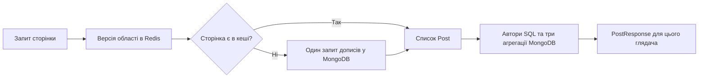

# Пункт 3. Кеш сторінок стрічки без повного очищення після лайка

## Проблема і результат

Раніше `PostService` кешував готовий `List<PostResponse>`. Така відповідь містила одночасно текст допису, автора, кількість лайків/коментарів і персональне `likedByMe`. Ключ включав глядача. Після лайка, коментаря, зміни профілю або допису `FeedCacheService.invalidate()` очищав **весь** `post-feed` через `allEntries=true`.

Тому популярна стрічка з активними записами часто втрачала кеш, а однакові тексти дописів зберігалися окремо для кожного глядача.

Тепер кеш містить **тільки сторінку об'єктів `Post`**. Дані автора, лічильники та `likedByMe` завжди збираються пакетно після отримання сторінки. Створення/видалення допису змінює версії тільки загальної стрічки та стрічки його автора. Лайки, коментарі й профіль не очищають кеш сторінок.

Це зміна політики кешування, а не доказ певного RPS чи кількості одночасних користувачів.

## Які файли змінилися

| Файл бекенду | Відповідальність |
| --- | --- |
| `post/service/FeedCacheService.java` | Читання/запис сторінки, версії областей, локальне обмеження одночасних промахів |
| `post/service/PostService.java` | Перевірка пагінації, завантаження сторінки через кеш, свіже пакетне доповнення відповіді |
| `post/entity/Post.java` | `Serializable` для стандартного Redis-серіалізатора Spring |
| `post/service/LikeService.java`, `CommentService.java` | Збереження змін без очищення сторінок |
| `profile/service/ProfileService.java` | Оновлення профілю без очищення сторінок |
| `config/MongoQueryIndexMigration.java` | Міграція лайків більше не очищає кеш: лайки читаються свіжими |

Шлях до цих файлів починається з `backend/src/main/java/com/net/cardo/xcopybackend/`.

## Як проходить читання

1. Контролер передає глядача, номер і розмір сторінки в `PostService`.
2. `PostService.page()` перевіряє обмеження: сторінка 0–1000, розмір 1–50. Некоректний запит не потрапляє в кеш.
3. Для загальної стрічки вибирається область `all`; для профілю — `author:<UUID>`.
4. `FeedCacheService.load()` бере поточну випадкову версію цієї області з Redis.
5. Якщо версії ще немає, створює її через `setIfAbsent` і перечитує. Паралельні перші запити використовують версію, яка фактично перемогла.
6. Ключ сторінки складається з області, версії, номера та розміру: `author:<UUID>:<version>:0:20`. Ідентифікатора глядача тут немає.
7. На влучанні кеш повертає `List<Post>`. На промаху виконується один обмежений запит дописів і його результат записується в Redis.
8. `PostService.toResponses()` збирає ID дописів та авторів. Один SQL-запит підвантажує авторів, три MongoDB-агрегації — кількість лайків, кількість коментарів та лайки конкретного глядача.
9. З цих даних збирається персональна відповідь. `likedByMe` одного користувача не потрапляє у відповідь іншого через спільний кеш.

Стрічка підписок залишається без цього кешу. Її набір авторів залежить від користувача та підписок; цей пункт не вводить великих ключів зі списками підписок.

## Як працює оновлення версій

При створенні/видаленні допису автора A:

1. Зміна зберігається у MongoDB.
2. `invalidate(A)` генерує новий випадковий UUID.
3. Одна операція Redis `MSET` встановлює цю версію для `all` і `author:A`.
4. Наступний читач складає ключ уже з новою версією і не може знайти стару сторінку.
5. Старі значення залишаються недоступними за поточною версією і самі видаляються після TTL 30 секунд.

Для `author:B` версія зберігається. Створення допису A не руйнує кеш чужого профілю B.

`MSET` атомарно змінює обидва ключі в поточному **окремому Redis-сервері**. Перехід на Redis Cluster потребуватиме перевірки hash slots і способу інвалідації. Офіційна семантика: [Redis MSET](https://redis.io/docs/latest/commands/mset/).

Тут немає обходу всіх ключів, `KEYS`, `SCAN` чи `allEntries=true` після звичайної зміни. Робота інвалідації не зростає з кількістю кешованих сторінок.

## Навіщо випадкові версії, а не 0 → 1

Уявімо запит R, який прочитав версію V1, а потім довго отримує сторінку з MongoDB. За цей час допис видалили та змінили версію на V2. Якщо R пізніше збереже старий результат, він запише його під V1. Нові читачі шукають V2, тому застарілий запис не повертається в активний кеш.

Якщо ключ версії випадково видалений або витіснений, нова випадкова версія також не збігається зі старим початковим ключем. Фіксоване повернення до версії `0` могло б оживити старий запис.

Запит, який почався до завершення запису, все ще може завершитися зі старим знімком. Це не лінеаризована транзакція між Redis та MongoDB.

## Навіщо 64 блокування

Одночасні промахи одного ключа можуть запустити багато однакових запитів у MongoDB. Масив із 64 об'єктів `stripes` вибирає блокування за хешем області, сторінки та розміру. Перший запит заповнює кеш, наступний перечитує його.

Розмір масиву сталий: на кожен можливий ключ не створюється новий об'єкт блокування. Дві різні сторінки з однаковим хешем можуть почекати одна одну. Це локальне блокування одного JVM, не розподілений захист від промахів між кількома backend-процесами.

## Свіжість і помилки

| Ситуація | Поведінка |
| --- | --- |
| Лайк або коментар | Кеш `Post` зберігається; наступна відповідь читає актуальні агрегації |
| Ім'я чи аватар | Кеш `Post` зберігається; автор читається з PostgreSQL |
| Новий/видалений допис | Нова версія загальної області та області автора |
| Пряме ручне редагування MongoDB | Не викликає інвалідацію; сторінка може бути старою до TTL |
| Помилка читання/запису кешу | Читання сторінки використовує MongoDB; помилка кеш-запису не приховує успішне читання |
| Помилка самого MongoDB | Повертається помилка; код не маскує її порожньою відповіддю і не повторює запит як «cache fallback» |
| Помилка інвалідації після запису | Помилка передається виклику; запис у MongoDB вже міг завершитися. Спільної транзакції двох сховищ немає |

Fallback кешу не означає повну працездатність застосунку без Redis: Redis також потрібен окремим механізмам автентифікації.

Версії областей не мають TTL, а сторінки мають 30 секунд із поточного `application.properties`. Версія — один короткий ключ на активовану область автора та один для `all`. Це окрема, значно менша категорія пам'яті; на дуже великій кількості авторів її теж потрібно враховувати.

Кеш має нове ім'я `post-pages-v2`: старі серіалізовані `PostResponse` не читаються як `Post`. Старий `post-feed` доживає свій TTL. `Post` реалізує `Serializable`, оскільки стандартний менеджер використовує JDK-серіалізацію. TTL задається конфігурацією застосунку, а не самим інтерфейсом `Cache`: [Spring Data Redis Cache](https://docs.spring.io/spring-data/redis/reference/redis/redis-cache.html).

## Що коштує читання

Для непорожньої сторінки:

| Стан | Дописи MongoDB | Агрегації MongoDB | Автори SQL |
| --- | --- | --- | --- |
| Промах | 1 запит | 3 | 1 пакетний запит для коректних ID авторів |
| Влучання | 0 | 3 | 1 пакетний запит для коректних ID авторів |

Це бюджет саме завантаження даних сторінки: автентифікація, контролер та операції Redis рахуються окремо. Для порожньої сторінки доповнення пропускається.

**Компроміс:** старий повністю теплий кеш готової відповіді міг обійтися без цих SQL/агрегацій. Новий підхід робить їх кожного разу заради свіжості та спільного кешу незалежно від глядача. Виграш очікується у зменшенні масових скидань і дублювання сторінок при активних записах; універсальне зниження затримки не доведене.

## Перевірки

`FeedCacheServiceTest` перевіряє спільну сторінку, окремі сторінки пагінації, інвалідацію тільки потрібних областей, гонку старого читання з новою версією, fallback та втрату ключа версії.

`PostFeedBatchIntegrationTests` працює з реальними PostgreSQL, MongoDB та Redis. Доданий сценарій прогріває сторінку, змінює лайк/коментар/автора і читає її іншим глядачем: перевіряє актуальні поля, нуль нових MongoDB `find` для дописів, три агрегації та один SQL. Потім видаляє допис через сервіс і перевіряє нову сторінку з 19 елементів та новий `find`.

Ізольовані тести: з `backend` виконати `./gradlew unitTest` (`.\gradlew.bat unitTest` у PowerShell). Повний `check` потребує окремих тестових баз; CI надає їх. Не запускайте інтеграційні тести з виробничими параметрами.

## Як пояснити на співбесіді

«Спочатку ми кешували готову персональну відповідь і після кожного лайка очищали весь кеш. Я розділив повільно змінювану сторінку дописів і динамічні дані. Сторінка спільна для глядачів, а лічильники, автори й likedByMe збираються свіжими пакетними запитами. При зміні складу стрічки я атомарно міняю версії загальної області та області автора. Старі ключі більше не використовуються і доживають TTL. Версії також захищають від пізнього запису старого запиту. Це зменшує масові скидання кешу, але додає читання динамічних даних на кожен запит, тому ефект на пропускну здатність треба вимірювати».
