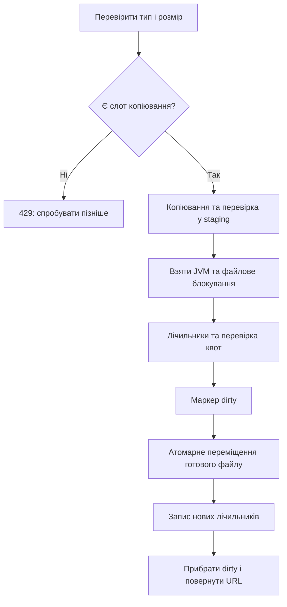

# Пункт 4. Медіафайли без повного обходу каталогу на кожен upload

Оновлення надійного видалення: [фонове очищення допису](RELIABLE_POST_DELETION_UK.md) використовує `deleteOrThrow()`, щоб повторювати спробу при справжній помилці файла. Старий `delete()` залишається best-effort обгорткою для компенсації існуючих викликів. Обидва використовують той самий облік квот.

## Проблема і результат

Раніше `MediaStorageService.store()` був `synchronized`. Усередині він брав файлове блокування, проходив `Files.walk()` по всьому сховищу й каталогу власника, рахував байти/файли, а потім **під тим самим блокуванням** копіював файл.

Чим більше накопичувалося файлів, тим довше тривала перевірка навіть маленького upload. Повільне читання одного файлу затримувало всі інші завантаження в цьому сервісі. Видалення не використовувало спільну процедуру обліку.

Тепер копіювання і перевірка формату виконуються в тимчасовому каталозі, до чотирьох копіювань одночасно на процес. Коротка спільна секція перевіряє два маленькі файли лічильників, переміщує готовий файл і оновлює облік. Повний обхід потрібен при першій операції нового екземпляра сервісу та після незавершеного оновлення.

«Коротка» тут означає, що секція не копіює вхідний потік і в звичайному випадку не обходить каталог. Вона все ще виконує дискові операції та `force()`, тому її час залежить від диска.

## Файли та ролі

| Файл | Що робить |
| --- | --- |
| `MediaStorageService.java` | Валідує upload, обмежує одночасні копіювання, копіює в staging, застосовує квоти, зберігає/видаляє файл |
| `MediaQuotaLedger.java` | Блокує операцію обліку, читає/оновлює лічильники, відновлює їх із фактичних файлів |
| `PostService.java` | Якщо збереження допису в MongoDB не вдалося, викликає видалення вже завантаженого медіафайлу |
| `MediaWebConfig.java` | Не дозволяє HTTP-доступ до прихованих службових каталогів |

Перші три — `backend/src/main/java/com/net/cardo/xcopybackend/post/service/`, конфігурація — сусідній `config/`.

## Як виглядає сховище

```text
uploads/posts/
  <owner-UUID>/
    <random-UUID>.png          готовий публічний файл
  .staging/
    upload-<random>.part       незавершений/ще не опублікований файл
  .quota.lock                  файл для міжпроцесного блокування
  .quota-v1/
    total                     загальні байти та кількість
    owner-<UUID>              байти та кількість власника
    dirty                     існує лише під час незавершеної зміни
```

Приклад вмісту лічильника: `120000 3` — 120000 байтів у трьох файлах. Службові каталоги розміщені в тому самому збережуваному media volume; окрема база чи нова хмарна послуга не потрібні.

Публічний URL готового файлу зберігається як `/media/posts/<owner>/<filename>`. `PublicMediaResolver` відхиляє шлях із компонентом, що починається на крапку, тому `.staging`, `.quota-v1` та `.quota.lock` не видаються через статичний HTTP-обробник.

## Покроково: збереження файлу

1. Перевіряємо власника, непорожність та заявлений розмір до 25 MiB. Надмірний розмір відхиляється ще до читання потоку.
2. Перевіряємо дозволений MIME-тип. Розширення вибирає сервер; ім'я користувацького файлу не визначає шлях.
3. `Semaphore.tryAcquire()` бере один із чотирьох слотів копіювання. П'ятий одночасний upload отримує HTTP 429 без очікування в новій внутрішній черзі.
4. Створюємо прихований тимчасовий файл. Перевіряємо вільне місце з резервом 512 MiB та запасом під три інші копіювання по 25 MiB.
5. Відкриваємо вхідний потік, читаємо заголовок і перевіряємо сигнатуру PNG/JPEG/GIF/WebP/MP4/WebM/MOV. MIME від браузера сам по собі не є доказом формату. Це базова перевірка сигнатури, не повне декодування чи антивірус.
6. Копіюємо блоками по 8192 байти. Якщо реальний потік більший за заявлений розмір або 25 MiB — 413. Якщо він коротший — помилка запису. До завершення перевірки файл не публікується.
7. Після закриття потоків беремо блокування обліку. Тільки тепер починається спільна секція.
8. При потребі відновлюємо лічильники. Читаємо `total` та `owner-UUID`: це два невеликі файли, без обходу всіх медіафайлів.
9. Повторно перевіряємо загальні та особисті ліміти байтів/кількості й фактичне вільне місце. Перевірка у формі `newSize > limit - used` уникає переповнення при додаванні.
10. Створюємо маркер `dirty` і викликаємо `force(true)` для його файлового каналу.
11. Переміщуємо готовий файл у каталог власника через `ATOMIC_MOVE` на тому самому файловому сховищі. Тут немає повторного копіювання 25 MiB під блокуванням. Файлова система повинна підтримувати атомарне переміщення; при відсутності підтримки операція завершується помилкою, без небезпечного fallback.
12. Записуємо новий особистий та загальний лічильник. Кожен запис проходить через `counter.tmp`, `force(true)` та атомарну заміну.
13. Видаляємо `dirty`, звільняємо блокування й повертаємо URL.
14. У `finally` видаляємо залишок тимчасового файлу та повертаємо слот семафора, зокрема після помилки.



## Навіщо два блокування

`ReentrantLock` спільний для нормалізованого кореневого шляху всередині JVM. Він також захищає різні екземпляри сервісу, які працюють із тим самим каталогом. Без нього два потоки JVM можуть отримати `OverlappingFileLockException` замість очікування файлового блокування.

`FileChannel.lock()` на `.quota.lock` захищає облік між процесами, які бачать той самий каталог і використовують цей протокол. Перевірка квот та її застосування проходять разом: два запити не можуть обидва використати один останній слот.

Семафор має іншу роль: він обмежує обсяг **незавершених копіювань**, а не облік готових файлів. Він локальний для екземпляра сервісу. Поточний deployment має один backend; чотири слоти не є глобальним лімітом для майбутніх реплік.

## Відновлення після збою

Файл і два лічильники — різні файлові записи. Не можна вдавати, що вони оновлюються як одна транзакція бази даних. Тому перед змінами створюється `dirty`.

| Коли стався збій | Що відбудеться |
| --- | --- |
| Під час копіювання до commit | Готового файлу немає, квота ще не списана; звичайна помилка прибирає `.part` |
| Після `dirty`, до переміщення | Наступна операція перерахує фактичні файли |
| Після переміщення, до обох лічильників | `dirty` залишається; наступна операція перерахує стан, а не повірить частковим лічильникам |
| Перехоплена помилка commit після переміщення | Сервіс намагається прибрати неопублікований файл ще під блокуванням; `dirty` залишається для узгодження |
| Після лічильників, до видалення `dirty` | Повторне перерахування безпечне: джерело істини — готові файли |
| Нова JVM після перезапуску | Перша операція перераховує файли навіть без `dirty` |

Повний обхід виконується під тими самими блокуваннями. Він пропускає приховані службові шляхи й символьні посилання на файли, рахує всі звичайні публічні файли для загального ліміту та файли виду `<UUID>/<filename>` для власника. Старі плоскі файли враховуються в загальному ліміті. Лічильники власників перебудовуються, тому видалені каталоги не залишають старий борг.

Маркер і `force()` — захист від перерваної роботи процесу та часткових операцій. Це не обіцянка захисту від довільного пошкодження диска або раптової втрати живлення: окреме примусове збереження метаданих каталогів тут не реалізоване.

## Як проходить видалення

1. Перевіряємо префікс URL, нормалізований шлях, вкладеність у кореневий каталог і відсутність прихованих компонентів.
2. Беремо ті самі JVM/OS-блокування.
3. Якщо файл уже відсутній, нічого не віднімаємо. Повторне видалення не звільняє квоту двічі.
4. Зчитуємо розмір і поточні лічильники.
5. Створюємо `dirty`, видаляємо файл, зменшуємо відповідні лічильники та прибираємо маркер.

При помилці видалення сервіс, як і раніше, не замінює основну відповідь помилкою cleanup. Якщо файл фізично залишився, він продовжує займати місце й квоту. Після часткового видалення `dirty` запускає узгодження наступної операції.

Окремо `PostService.createPost()` прибирає вже збережений медіафайл, якщо MongoDB не прийняла новий допис. Це зменшує кількість файлів, які з'явилися через звичайну помилку збереження. Збій процесу між двома сховищами все ще може залишити файл без допису: розподіленої транзакції між MongoDB та диском тут немає.

## Ліміти та відповіді

| Обмеження | Значення за замовчуванням |
| --- | --- |
| Один файл | 25 MiB |
| Власник | 500 MiB та 500 готових файлів |
| Усі власники | 5 GiB та 10000 готових файлів |
| Резерв диска | 512 MiB; додатковий запас на паралельні staging-копіювання перед читанням |
| Одночасне копіювання | 4 на екземпляр сервісу, далі HTTP 429 |

Ліміти власника/всього сховища залишилися існуючими `app.media.*` налаштуваннями. Перевищення квоти або нестача диска повертає 507; недозволений формат — 415; надмірний розмір — 413.

Аватари використовують цей самий сервіс і загальну квоту власника; їхній попередній окремий ліміт 5 MiB у `ProfileService` зберігається.

## Межі рішення та обслуговування

- Звичайна операція має сталу кількість читань/записів лічильників незалежно від кількості готових файлів. Перший обхід після запуску чи аварії все ще має вартість O(кількість файлів).
- Файловий commit залишається послідовним. Ми прибрали з нього копіювання та регулярний `Files.walk`, а не зробили диск необмежено паралельним.
- Максимум активних `.part` одного сервісу — приблизно 100 MiB. Це не враховує upstream multipart-буферизацію вебсервера, аварійні залишки або інші процеси.
- Після аварійного завершення `.part` може залишитися. Він не є публічним і не враховується як готовий файл, але займає диск. Автоматично прибирати чужі активні копіювання небезпечно; очищати залишки слід при зупинених upload-процесах.
- Ручні зміни готових файлів під час роботи обходять протокол лічильників. Після такого обслуговування потрібно перезапустити backend або, при зупинених процесах, позначити ledger `dirty` перед наступним запуском. Не редагуйте цифри вручну.
- Облік не призначений для кількох серверів із різними локальними дисками. Для object storage потрібні інший протокол квот, резервування та узгодження збереження.
- Резерв вільного місця враховує паралельність одного сервісу. Інші програми або майбутні репліки також можуть заповнити диск; абсолютної гарантії вільного місця під чужі записи немає.
- Квота рахує розмір вмісту файлів, а не всі накладні витрати файлової системи; фактичне місце додатково перевіряється через `getUsableSpace()`.

## Що перевірено тестами

`MediaQuotaLedgerTest` перевіряє:

1. Початковий облік існуючих файлів і перерахування при новому екземплярі сервісу.
2. Відновлення після `dirty` з неправильним/незавершеним лічильником; staging не потрапляє в квоти.
3. Два екземпляри, один останній слот: лише один commit успішний, другий отримує 507.
4. Повільний потік upload не затримує завершення іншого upload.
5. Подвійне видалення не списує квоту повторно; неправильний формат не залишає `.part`.
6. Звичайний commit не перечитує сторонні каталоги; після `dirty` зовнішній файл потрапляє в облік.
7. П'яте паралельне копіювання отримує 429, після завершення попередніх слоти доступні знову.
8. Відсутній файл лічильника існуючого власника запускає перерахування, а не обнуляє його квоту.

Існуючі `MediaStorageTest` та `MediaQuotaBoundaryTest` продовжують перевіряти квоти байтів/кількості, підміну типу, некоректну довжину, завеликий файл та обхід шляху. `MediaWebConfigTest` перевіряє недоступність приватних файлів через resolver. `PostServiceTest` перевіряє cleanup після невдалого запису допису.

Це локальні файлові тести, а не тест вимкнення живлення, окремих операційних процесів або вимірювання throughput. Браузерні E2E додатково перевіряють реальне завантаження/показ/видалення файлу.

## Як пояснити на співбесіді

«Попередня перевірка квот обходила всі файли при кожному upload і тримала спільне блокування під час копіювання. Я розділив підготовку та commit: до чотирьох файлів копіюються в прихований staging паралельно, потім коротка секція під JVM і файловим блокуванням читає загальний та особистий лічильники, перевіряє квоти і атомарно переміщує готовий файл. Перед змінами створюється dirty-маркер. Якщо процес зупинився між файлом і лічильниками, наступна операція відновлює облік із диска. Видалення використовує той самий протокол. Таким чином звичайна перевірка більше не залежить від усієї кількості медіафайлів, а паралельність обмежена, щоб не перевантажувати диск».
