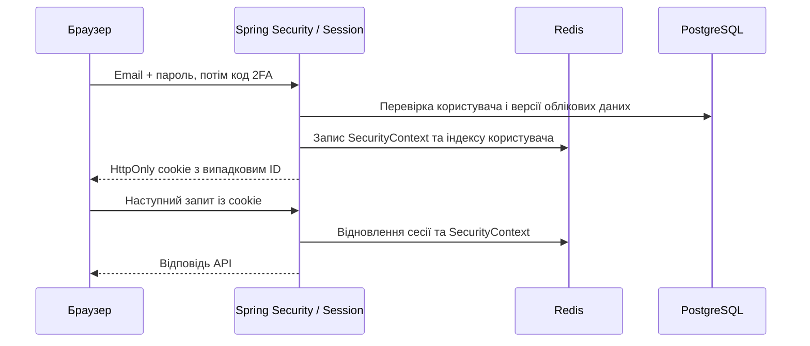

# Перехід із JWT на Spring Session + Redis

## Чому замінили JWT

Раніше cookie містила підписаний JWT, але кожен захищений запит усе одно перевіряв у PostgreSQL користувача та `tokenVersion`, а потім завантажував `UserDetails`. Відкликання працювало, проте незалежної від бази перевірки JWT не було.

Для браузерного застосунку з одним бекендом і вже наявним Redis серверні сесії простіші: браузер зберігає лише випадковий ID, а сервер керує строком дії й видаленням сесій. Кілька екземплярів бекенду можуть читати ті самі сесії з Redis без прив’язування браузера до одного сервера.

Це не твердження, що JWT небезпечний. Ми обрали механізм, який краще відповідає поточному застосунку та керуванню браузерними входами.

## Шлях запиту

Відновлення авторизації більше не виконує SQL-запит. Операції API, яким потрібен поточний профіль, пости або підписки, і надалі читають свої дані з баз. Заміна авторизації не прибирає ці бізнес-запити.

## Що саме змінилося

1. Додано `spring-boot-starter-session-data-redis`. `SessionConfig` вмикає `RedisIndexedSessionRepository` через `@EnableRedisIndexedHttpSession`. Простір ключів — `xcopy:sessions:v1`, окремий від кешу стрічок та кодів входу.
2. Видалено `JwtService`, `JwtFilter`, бібліотеки JJWT, передачу JWT у cookies/Bearer та створення JWT-секрету в деплої. Google OIDC продовжує використовувати стандартний ID token провайдера для перевірки Google-входу: це окремий протокол, не JWT-сесія нашого API.
3. `SecurityConfig` явно використовує `HttpSessionSecurityContextRepository` з `requireExplicitSave(true)`. Контекст зберігає сервіс успішного входу, а не довільний запит наприкінці обробки. Зайве кешування запитів та стандартний `/logout` вимкнено: застосунок має власний CSRF-захищений endpoint виходу.
4. У Redis зберігаються `SecurityContext`, права та мінімальний `SessionPrincipal(userId, email)`. Пароль, його hash, JPA-сутність і Google access token у кінцеву браузерну сесію не записуються. Використовується стандартна Java-серіалізація Spring Session; Redis має залишатися приватним і доступним лише довіреним сервісам.
5. Поточний користувач у ресурсних операціях визначається за ID із сесії через `SessionAccounts`. Якщо обліковий запис видалили й потім створили інший із тим самим email, стара сесія не повинна приєднатися до нового запису. Це заміна наявного SQL-пошуку профілю, а не додаткова перевірка авторизації в базі на кожному запиті.

## Cookie та строки дії

Cookie називається `XCOPY_SESSION_ID`. Нова назва відокремлює її від старого `XCOPY_SESSION`, де був JWT. Старий JWT-cookie очищається після входу та виходу, а старі JWT/Bearer більше не авторизують запити.

Властивості cookie: `HttpOnly`, `Secure` у production, `SameSite=Lax`, `Path=/`, строк зберігання в браузері — доба. `Path=/` потрібен і для `/oauth2/authorization/google`, і для `/login/oauth2/code/google`. Для локальних HTTP-тестів `APP_AUTH_SECURE_COOKIES=false`; на production значення за замовчуванням `true`.

Серверний idle timeout — **30 хвилин**. Активність продовжує цей інтервал, але `SessionLifetimeFilter` обмежує автентифіковану сесію **24 годинами від створення**. Cookie, яка ще є в браузері, не робить прострочену або видалену серверну сесію дійсною. Застаріла сесія не блокує публічні сторінки входу й відновлення пароля.

## Email + пароль + 2FA

Перевірка пароля лише починає challenge з одноразовим кодом. У Redis зберігаються ID користувача, версія облікових даних та hash коду; TTL і ліміти спроб збережено. Після правильного коду challenge атомарно споживається.

`TwoFactorService.verifyCode()` тепер повертає внутрішній `LoginProof`, а не токен. Цей об’єкт не надсилається фронтенду й не приймається від клієнта як спосіб входу. `BrowserSessionService.authenticate()` повторно перевіряє версію, створює нову сесію, індексує її за user ID і явно зберігає контекст. JSON-відповідь залишається `{authenticated:true}`.

Попередня сесія повністю інвалідується перед створенням нової. Це захищає від session fixation: ID сесії до входу не стає ID авторизованої сесії, а її сторонні атрибути не переносяться.

## Google-вхід

Одноразові стартовий ключ і код обміну залишаються прив’язаними до браузера. Тимчасова OAuth-сесія живе 5 хвилин. Успішний callback видає одноразовий код обміну на 60 секунд, прив’язаний до ID користувача, версії облікових даних і browser binding.

Для OAuth-фільтра налаштовано `NullSecurityContextRepository`: callback не зберігає повноцінну авторизацію до успішного обміну коду. Тимчасова сесія інвалідується й контекст очищається навіть при помилці видачі коду. Endpoint обміну перевіряє binding, споживає код і створює кінцеву серверну сесію тим самим шляхом, що й 2FA. Налаштування першого пароля після Google-входу збережено.

## Вихід і скидання пароля

**Звичайний вихід** інвалідує лише поточну сесію та очищає її cookie. Другий пристрій залишається авторизованим. Endpoint потребує CSRF-токена. Це свідома відмінність від попереднього збільшення `tokenVersion` під час кожного виходу, яке виходило одразу з усіх пристроїв.

**Скидання пароля** відкликає всі сесії користувача через індекс `FindByIndexNameSessionRepository`. Не використовується загальне очищення Redis або `KEYS *`. Також збільшується `credentialVersion`, тому старі 2FA-challenges і вже видані, але ще не обміняні Google-коди не створять нову сесію.

Java-поле перейменовано з `tokenVersion` на `credentialVersion`, але SQL-колонка залишається **`token_version`**. Нова колонка й ручне перенесення значень не потрібні. Версія тепер перевіряється на шляху входу, а не при відновленні кожної сесії.

## Паралельний вхід і reset: навіщо блокування

Лише видалення знайдених сесій недостатньо: паралельний вхід міг би зберегти стару авторизацію одразу після очищення.

Остаточна видача сесії та скидання пароля беруть **одне й те саме pessimistic write lock рядка користувача** в PostgreSQL. Блокування діє в транзакції й між різними екземплярами бекенду:

- Якщо вхід завершується першим, Redis уже має індекс і контекст сесії, коли lock звільняється. Наступний reset знайде й видалить цю сесію.
- Якщо reset завершується першим, вхід після отримання lock бачить нову `credentialVersion` та відхиляє старий proof.

`FlushMode.IMMEDIATE` потрібен саме для запису сесії **до звільнення lock**, а не наприкінці HTTP-запиту. `SaveMode.ON_SET_ATTRIBUTE` та явне збереження контексту не повинні повторно записувати відкликану авторизацію під час завершення старого запиту. Це покрито окремим тестом із реальним Redis.

Блокування й SQL-запит тут оплачуються лише під час входу/reset. Активний HTTP-запит, який уже пройшов авторизацію до відкликання, може завершити свою дію: відкликання сесії не є скасуванням уже виконуваної операції.

## Поведінка при збоях

| Подія | Поведінка |
| --- | --- |
| Невідомий, видалений або прострочений ID | Захищений API повертає 401 |
| Redis недоступний під час читання сесії | Немає переходу на локальну авторизацію; повертається 503 із `Retry-After: 2` |
| Помилка Redis на шляху створення/reset | Успіх не підтверджується; SQL-транзакція reset відкочується |
| SQL rollback після часткового видалення Redis-сесій | Частину користувацьких сесій уже могло бути відкликано; це безпечніше, ніж залишити новий пароль зі старими входами |
| Redis помилився після вже відправленої HTTP-відповіді | Статус змінити неможливо; збій фіксується в журналі, наступний запит повторно перевіряє Redis |
| Бекенд перезапустився, Redis зберіг дані | Сесії можуть залишитися доступними |
| Сесії втрачено через очищення/втрату Redis | Потрібен повторний вхід |

`SessionAvailabilityFilter` обгортає Spring Session, оскільки завантаження/збереження сесій відбуваються поза MVC й не завжди потрапляють у `ControllerAdvice`.

SQL і Redis не є однією розподіленою транзакцією. Існуючий Redis у Compose має AOF і volume, але один Redis залишається точкою відмови. Відновлення старого snapshot Redis може повернути старі сесії; під час такого аварійного відновлення треба інвалідувати простір сесій перед відкриттям трафіку. Прямі зміни паролів у SQL обходять сервіс відкликання, тому пароль слід змінювати штатним reset-процесом. Майбутнє видалення акаунта в застосунку також має викликати відкликання його сесій.

## Перевірки та оновлення

Ізольовані тести перевіряють 2FA, browser binding, одноразовість кодів, зміну ID при вході, старі proofs, CSRF, вихід із одного пристрою, абсолютний строк, безпечний 503 та прив’язування ресурсу до user ID.

Інтеграційні тести з реальними PostgreSQL і Redis перевіряють збереження/відновлення сесій, індекс користувача, вихід, відкликання двох пристроїв, прострочення та відсутність відновлення авторизації при завершенні запиту після reset. Браузерні E2E використовують реальний бекенд, пошту і тестовий OIDC-провайдер; вони перевіряють email/Google-вхід, перший пароль, reset двох пристроїв, ротацію ID та вихід лише з поточного браузера.

Після злиття CI/CD доставляє новий код звичайним шляхом. Для цієї міграції не потрібні ручне редагування таблиць або новий JWT-секрет на Lightsail. Старі входи завершаться, користувачі ввійдуть знову. Не варто одночасно тримати під трафіком старі JWT-екземпляри й нові session-екземпляри. Старі змінні JWT у серверному `.env` більше не використовуються; їх можна прибрати окремо.

## Як пояснити на співбесіді

«У браузерному застосунку JWT все одно перевірявся через PostgreSQL на кожен запит. Я замінив його серверними сесіями Spring Session у Redis: браузер отримує випадковий ID в HttpOnly-cookie, а сервер зберігає мінімальну ідентичність і керує відкликанням. Вихід видаляє одну сесію, reset — усі сесії користувача. Щоб reset не програвав паралельному входу, обидва шляхи блокують рядок користувача, а Redis записує контекст до звільнення блокування. Компроміс — залежність від Redis та потреба враховувати часткові збої між SQL і Redis».

Офіційні джерела: [Spring Session Redis](https://docs.spring.io/spring-session/reference/4.0/configuration/redis.html), [явне збереження SecurityContext](https://docs.spring.io/spring-security/reference/servlet/authentication/session-management.html).
