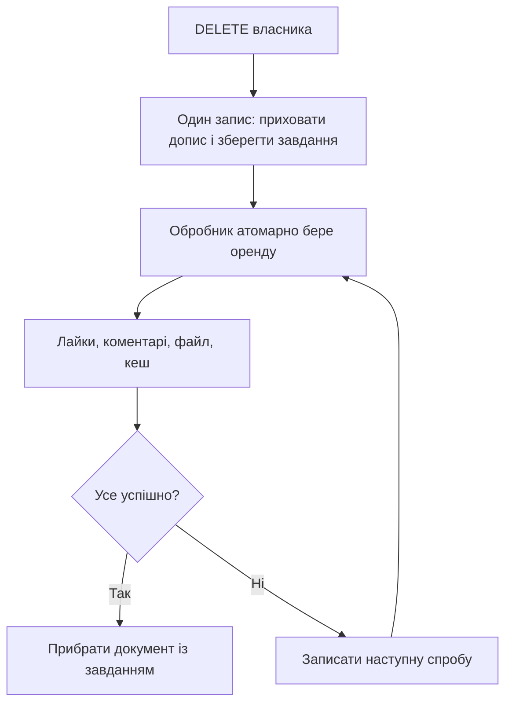

# Надійне видалення допису після часткових збоїв

## Проблема і вибір рішення

Раніше `deletePost()` фізично видаляв документ, потім пробував видалити файл і змінював версію кешу. Коментарі й лайки залишалися. Помилка файла могла ігноруватися, а після зникнення документа втрачалося посилання для повторної спроби.

Тепер видалення має дві частини: **логічне видалення з довговічним завданням** і **повторюване фізичне очищення**. Позначка й завдання містяться в одному документі допису. Це використовує атомарність одного документа MongoDB; окремого запису в чергу, який можна забути після зміни допису, немає.

Одна `@Transactional` не створила б спільну транзакцію з файловою системою та Redis. Поточна MongoDB працює окремим сервером, і це рішення не потребує переходу на replica set або брокер повідомлень. Семантика атомарного оновлення документа: [MongoDB atomicity](https://www.mongodb.com/docs/manual/core/write-operations-atomicity/).

## Файли та ролі

| Файл | Відповідальність |
| --- | --- |
| `post/service/PostService.java` | Авторизація власника, запит видалення, інвалідація сторінок |
| `post/repository/PostDeletionRepository*.java` | Атомарний запис позначки та завдання з journaled acknowledgement |
| `post/entity/Post.java` | Поле `deletionRequested`; внутрішні дані завдання залишаються в MongoDB |
| `post/repository/PostRepository.java`, `PostWindowRepositoryImpl.java` | Виключення позначених дописів із усіх стрічок |
| `post/service/PostCleanupService.java` | Захоплення завдань, очищення, повторні спроби, пошук пізніх осиротілих записів |
| `config/PostCleanupScheduler.java` | Запуск обмежених порцій у фоні |
| `post/service/MediaStorageService.java` | `deleteOrThrow()` повідомляє про помилку, зберігаючи протокол квот |
| `post/service/CommentService.java`, `LikeService.java` | Перевірка активності допису до і після створення залежності |

Java-шляхи починаються з `backend/src/main/java/com/net/cardo/xcopybackend/`.

## 1. Приймання DELETE

1. Контролер визначає поточного користувача за автентифікованою сесією.
2. Сервіс перевіряє, що користувач автентифікований і є власником наявного допису. Чужий допис — 403.
3. Якщо документа вже немає, повторний DELETE успішно завершується 204. Відсутній ресурс не потрібно видаляти вдруге.
4. Одним `updateOne` записуються `deletionRequested=true`, час запиту, час першої спроби й нульовий лічильник спроб.
5. Умова оновлення містить ID, власника та `deletionRequested != true`. Повторний DELETE не скидає backoff уже наявного завдання.
6. Запис використовує `WriteConcern.JOURNALED`: застосунок просить підтвердити запис у журналі MongoDB перед успішним завершенням цієї операції.
7. Змінюються версії кешу загальної стрічки й автора. Логічне видалення підтверджується через 204.

Усі запити стрічки, включно зі старою offset-пагінацією та новими курсорами, додають `deletionRequested != true`. Документи старого формату без цього поля залишаються активними. Нові коментарі й лайки перевіряють саме активність, а не лише фізичне існування документа.

204 підтверджує видалення допису з доступного представлення. Фізичне очищення залежностей відбувається пізніше. Публічний файл може ще короткий час існувати до успішної фонової спроби; миттєве відкликання доступу до всіх копій/кешів медіа цим протоколом не обіцяється.

## 2. Довговічне завдання

Приклад внутрішніх полів:

```text
deletionRequested: true
deletionRequestedAt: <date>
cleanupNextAttemptAt: <date>
cleanupAttempts: 0
cleanupLeaseToken: <тільки під час роботи>
cleanupLeaseUntil: <тільки під час роботи>
```

Текст, власник і `mediaUrl` ще зберігаються в документі, щоб обробник знав, що прибирати. Через HTTP стрічки цей документ уже не видається. Токен оренди й службові поля не включені в `PostResponse`.

Під час запуску створюється індекс `posts_cleanup_due_v1` на `deletionRequested, cleanupNextAttemptAt, _id`. Він підтримує вибір наступного готового завдання. Це додатковий службовий індекс; індекси стрічки з попередніх кроків залишаються.

## 3. Захоплення та виконання

Обробник шукає позначений документ, для якого вже настав `cleanupNextAttemptAt` і немає чинної оренди. `findOneAndUpdate` атомарно:

- записує випадковий `cleanupLeaseToken`;
- встановлює оренду на 30 секунд;
- збільшує `cleanupAttempts`;
- повертає захоплений документ після journaled acknowledgement.

Два обробники не можуть успішно отримати ту саму чинну оренду. Після аварії оренда спливає, і новий процес забирає завдання.

Послідовність роботи:

1. Видалити активні документи `likes` з потрібним `postId`.
2. Видалити активні документи `comments` з потрібним `postId`.
3. Видалити локальний файл через `deleteOrThrow()`.
4. Повторно змінити версії потрібних областей кешу.
5. Фізично видалити документ допису **лише за збігу свого lease token**.



Саме останній крок прибирає єдиний довговічний запис очищення. Поки будь-який попередній крок не завершився, посилання на файл і завдання зберігаються.

## 4. Чому повторення безпечне

Повторний `deleteMany` для тих самих лайків або коментарів видаляє нуль уже відсутніх документів. Відсутній файл вважається успішно видаленим. Облік квот не зменшується повторно. Зміна версії кешу може повторитися без відновлення видаленого допису.

Оренда може сплисти навіть у живого, але дуже повільного обробника. Тому її самої недостатньо: усі кроки повторювані, а фінальна зміна стану захищена токеном. Старий обробник не видалить документ або не перезапише backoff нової оренди.

Повторення завдання не гарантує одноразового виконання кожного кроку. Тут потрібні **at-least-once спроби з ідемпотентними діями**, а не обіцянка exactly-once для різних сховищ.

## 5. Backoff і обмеження роботи

Після помилки наступна спроба відкладається на 5, 10, 20, 40 секунд тощо, максимум на одну годину. Оренда звільняється умовним оновленням із власним токеном. Якщо процес упав раніше цього запису, залишається відновлення через спливання оренди.

Завдання не викидається після довільних N помилок. Постійна проблема з файлом залишає прихований документ із лічильником спроб для перевірки адміністратором. Інші готові завдання продовжують виконуватися.

За замовчуванням один scheduler виконує максимум п'ять завдань за прохід, після завершення чекає п'ять секунд. Далі перевіряється по 100 посилань у лайках і коментарях. `fixedDelay` не накопичує нові запуски, якщо попередній ще працює. Звичайні бюджети MongoDB з попереднього пункту залишаються; адміністративне створення індексу має довший бюджет.

Налаштування: `app.post-cleanup.jobs-per-run`, `orphan-batch-size`, `delay-ms`, `initial-delay-ms`, `scheduling-enabled`. Scheduler має один потік. Між кількома процесами завдання координуються орендою, але всі такі процеси повинні бачити те саме медіасховище. Кілька серверів із різними локальними дисками потребують іншої архітектури файлів.

## 6. Перегони з новим лайком або коментарем

Дві окремі колекції не дають зовнішнього ключа. Можлива послідовність: запит перевірив активність → видалення очистило залежності → запит запізно записав залежність.

Тому після створення залежності активність перевіряється повторно. Якщо допис уже позначений чи зник, щойно створений запис прибирається, а запит отримує 404.

Але процес може впасти **між записом і повторною перевіркою**. Для цього обробник додатково циклічно переглядає невеликі порції лайків/коментарів і видаляє записи, чий документ допису фізично відсутній.

Пошук не починає всю колекцію заново на кожному проході. Він продовжує за `_id` через нижню межу індексу та обмежений розмір порції. Включну граничну позицію пропускає лише якщо той самий документ досі існує. Це також працює, якщо попередня межа вже видалена. Використання межі індексу: [MongoDB cursor.min](https://www.mongodb.com/docs/manual/reference/method/cursor.min/).

Читання батьків виконується з primary. Для типових ObjectId та історичних рядкових ID перевіряються обидва BSON-представлення, щоб не сплутати наявний рядковий hex-ID з відсутнім ObjectId. Некоректні нестрокові/порожні `postId` автоматично не переписуються: вони потребують окремого аудиту.

Позиція перевірки тримається в пам'яті лише для двох колекцій. Після перезапуску перевірка починається спочатку; це безпечно, оскільки дії повторювані. Повний цикл залежить від обсягу даних, тому пізній сирітський запис не обов'язково зникне за п'ять секунд. Ідентифікатори дописів не можна повторно використовувати чи відновлювати вручну під час такого очищення.

## 7. Поведінка при збоях

| Місце збою | Результат і відновлення |
| --- | --- |
| До запису наміру | Допис залишається активним; клієнт може повторити DELETE |
| Timeout запису наміру | Результат може бути невідомим клієнту; повторний DELETE безпечний |
| Після приховування, до запуску worker | Завдання зберігається в MongoDB |
| Між очищенням лайків і коментарів | Наступна спроба повторює обидва кроки |
| Помилка видалення файла | Завдання та `mediaUrl` зберігаються; запланована нова спроба |
| Файл уже видалено, кеш недоступний | Завдання зберігається; відсутній файл не зменшує квоту повторно |
| Процес упав із чинною орендою | Інший запуск забирає завдання після спливання оренди |
| Старий worker завершився після нової оренди | Його токен не дозволить фінальне видалення/зміну чужого стану |
| Пізній запис залежності після видалення поста | Повторна перевірка або фоновий пошук сиріт прибере його |

Redis і MongoDB не змінюються однією транзакцією. Якщо інвалідація впала після прийняття наміру, клієнт може отримати помилку, хоча допис уже позначений. Фоновий обробник повторить інвалідацію. Старий запис кешу також обмежений TTL; запит, який почався до видалення, може завершитися зі старим знімком.

## Що перевірено

Unit-перевірки покривають права власника, повторне видалення, backoff, різницю між відсутнім файлом та реальною помилкою. Інтеграційні сценарії працюють у власній одноразовій MongoDB-базі та тимчасовому файловому каталозі:

- атомарний намір, приховування та збереження retry-стану після повторного DELETE;
- відмова диска, збереження завдання, відновлення новим worker;
- відмова кешу після видалення файла без подвійного списання квоти;
- спливання оренди та захист від застарілого власника;
- продовження інших завдань при постійній помилці одного;
- очищення пізніх залежностей і збереження записів чинного допису;
- обхід змішаних String/ObjectId ID та збереження історичного рядкового батька.

У Gradle-тестах автоматичний scheduler вимкнений: тести керують проходами й часом явно. У браузерному E2E використовується справжній scheduler окремого тестового сервера.

## Межі рішення

Це очищення **прийнятого видалення**. Аварія під час створення поста до запису його документа все ще може залишити медіафайл без посилання. Для цього потрібен окремий протокол pending upload/підтвердження посилання; простий обхід і видалення «старих файлів» був би небезпечним.

Історичні архіви дублікатів, резервні копії й зовнішні CDN-копії не є активними колекціями лайків/коментарів і цим механізмом не очищаються. Строки зберігання таких копій потребують окремої політики. Журнал MongoDB та файловий протокол не є спільною транзакцією чи гарантією від довільного пошкодження диска/втрати живлення.

## Як пояснити на співбесіді

«Я спочатку атомарно зберігаю намір видалення й приховую допис. Сам документ стає довговічним завданням, тому між зміною стану й записом у чергу немає розриву. Worker бере оренду, повторювано очищає лайки, коментарі, файл і кеш і тільки після успіху прибирає документ. Після аварії оренда спливає, помилки відкладаються з backoff. Токен захищає стан від старого worker. Окремий порційний пошук прибирає залежності від запізнілих записів, які могли пережити основне очищення. Це eventual consistency із безпечними повтореннями, а не удавана спільна транзакція MongoDB, диска й Redis».
